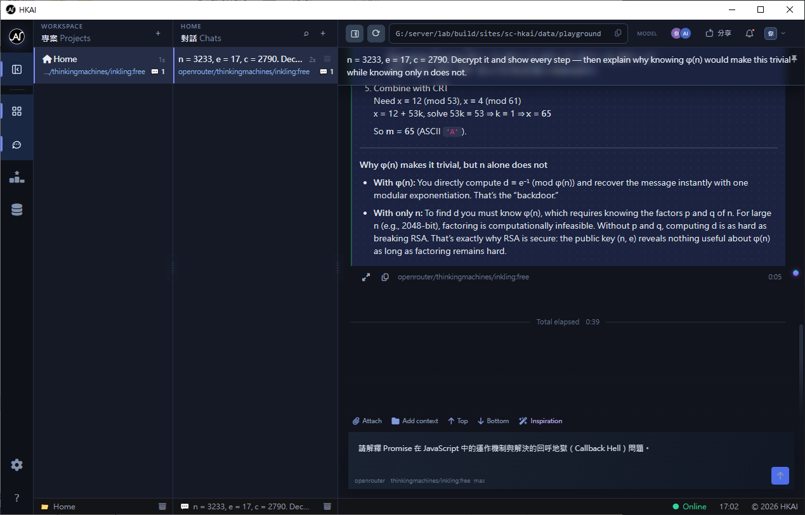
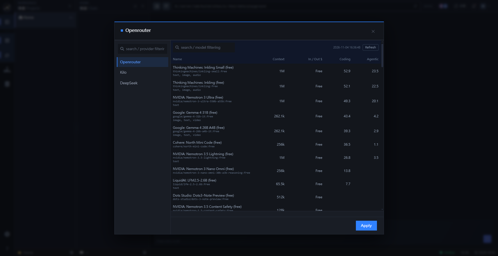
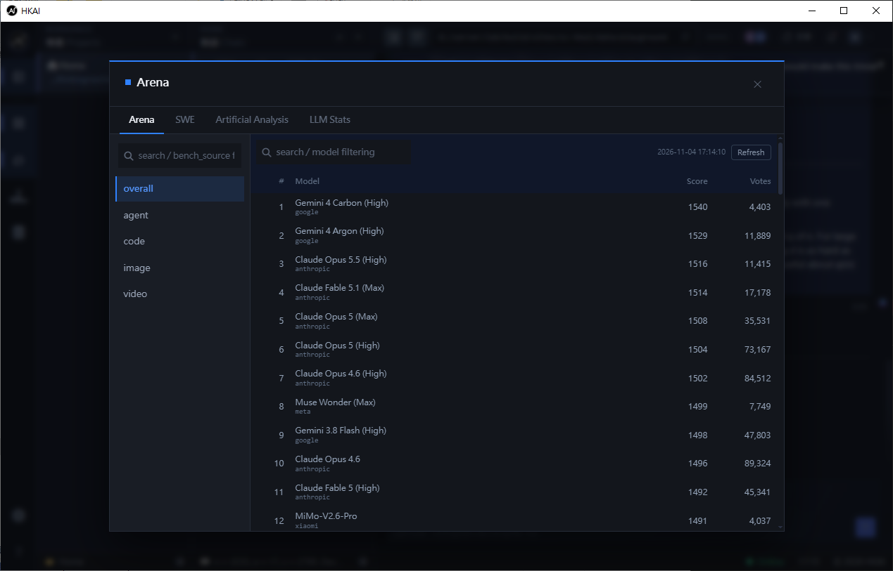

<!-- AUTO-GENERATED: edit section files under .github/docs/0.2.0/README/; do not edit this file directly -->

**English** · [繁體中文](README.zh-HK.md) · [简体中文](README.zh-CN.md)

# HKAI

> Nothing is impossible — only unimagined.

Local AI development console: a PHP web interface, a Python engine daemon, and SQLite. Your source code and conversations never leave your machine.

Everything runs from one folder — the bundled Apache and PHP-CGI serve the UI, and no internet connection is required after installation.

## Screenshots

## Features

- **Runs locally**: source code and conversations stay on your machine; no cloud dependency.
- **Approval before file changes**: the AI requests permission before every edit; nothing happens until you approve.
- **One-folder install**: `execute/HKAI.exe` starts its bundled Apache + PHP-CGI and opens the console; no PHP, Apache, or virtual host setup required.
- **Works offline**: every front-end library (jQuery, Bootstrap, Markdown, Mermaid, CodeMirror…) ships inside the folder — no CDN.
- **Per-project isolation**: conversations, history, and working directories stay separate.
- **Queue with auto relay**: send several prompts in a row; each one starts automatically when the previous finishes.
- **Observable long tasks**: process viewer plus activity log; abort at any time.
- **Built-in leaderboards**: SWE-bench, LMArena, AA, and LLM Stats help you choose models on evidence.
- **Safe upgrades**: installing over an existing site renames the old database to a timestamped backup before creating a fresh one.

<!-- screenshot: 02-chat-permission (chat with permission card) -->

## Requirements

| Item | Requirement |
|---|---|
| OS | Windows 10/11 (x64) |
| WebView2 | Evergreen Runtime (preinstalled on Windows 11) |
| C++ runtime | Microsoft Visual C++ 2015–2022 Redistributable (x64) |
| Python | 3.13 (used by the engine daemon) |
| Disk | approximately 3 GB |

No internet connection is needed to run; only the model provider you configure requires network access.

<!-- screenshot: 03-settings (settings page) -->

## Quick start

1. Extract the release folder and keep its structure intact.
2. Double-click `execute/HKAI.exe`. It starts its bundled Apache + PHP-CGI on a free localhost port and opens the console.
3. On first run the setup wizard opens: choose **fresh install**, or **upgrade** and point it at an existing site folder to import that database.
4. Add a provider API key in Settings, pick a model, and start a conversation.

### Manual mode (optional)

If you prefer your own web server, serve the site root as the document root with PHP 8.4 (FCGI) and open it in a browser. The bundled `execute/bin/apache-2.4.54` and `execute/bin/php-8.4.26` can be reused as-is.

### Engine

The Goose CLI is bundled at `externals/goose`. If `python` is not on `PATH`, set `python_executable=` in `.env`.

## Scope

Single workstation, single operator; AI collaboration scoped to local projects. Windows 10/11 is the supported platform.

## Engine (Agent)

| Engine | Description | Additional requirement |
|---|---|---|
| `goose` | Goose CLI engine driven over ACP | Bundled at `externals/goose` |

The engine is selected by `daemon_engine` in the site configuration; `goose_daemon` is the supported value.

## Supported providers

| Provider | Get an API key | Notes |
|---|---|---|
| OpenRouter | <https://openrouter.ai/keys> | Free models available |
| Kilo | <https://kilo.ai> | Sign up to obtain an API key |
| DeepSeek | <https://platform.deepseek.com/api_keys> | Pay per usage |

The three above are tested. Other providers are untested; configure them at your own risk.

## Benchmark sources

| Source | API key | Website |
|---|---|---|
| SWE-bench | Not required | <https://www.swebench.com/> |
| LMArena | Not required | <https://lmarena.ai/> |
| Artificial Analysis | Required | <https://artificialanalysis.ai/> |
| LLM Stats | Required | <https://llm-stats.com/> |

## License

MIT License · Copyright (c) 2026 Henry Yau

Bundled components (Apache, PHP, and the front-end libraries) keep their own licenses; see `THIRD_PARTY_LICENSES.md`.
