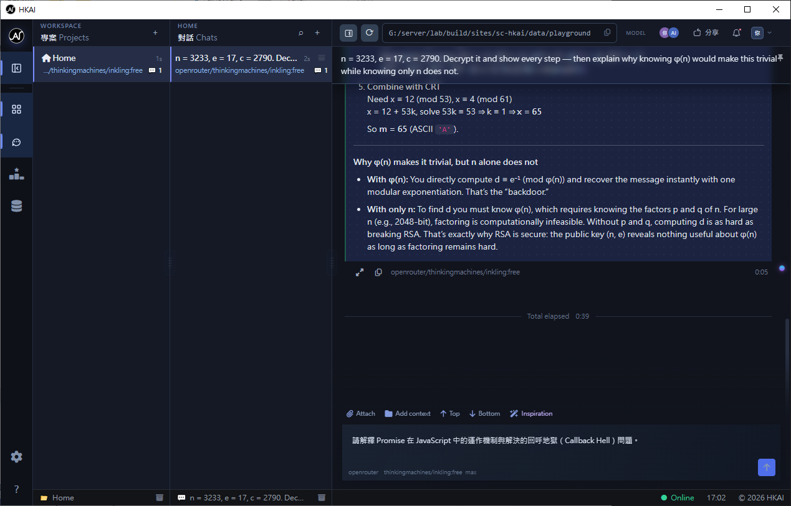
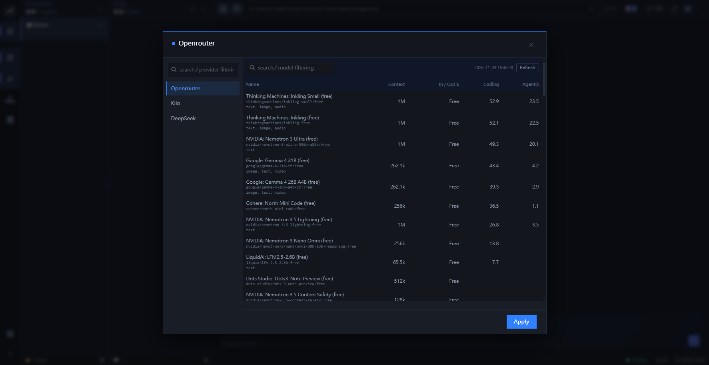
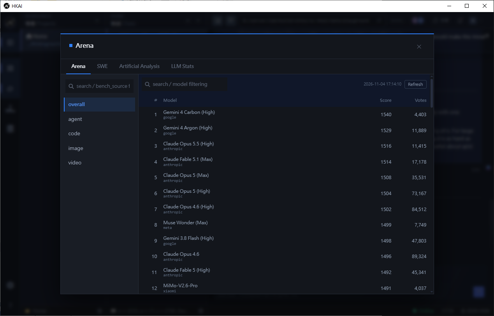

<!-- AUTO-GENERATED: edit section files under .github/docs/0.2.0/README/i18n/zh-CN/; do not edit this file directly -->

[English](README.md) · [繁體中文](README.zh-HK.md) · **简体中文**

# HKAI

> 没有做不到，只有想不到。

本机 AI 开发控制台：PHP 网页界面＋Python 引擎 daemon＋SQLite。源代码与对话不会离开你的电脑。

所有功能都在同一个文件夹内运行——内置 Apache 与 PHP-CGI 提供界面，安装后无需联网。

## 截图

## 功能

- **本机运行**：源代码与对话只留在你的电脑，无云端依赖。
- **改文件前先批准**：AI 每次修改文件都会先询问，你批准后才会动手。
- **一个文件夹安装**：`execute/HKAI.exe` 会启动内置 Apache＋PHP-CGI 并打开界面，无需另装 PHP、Apache 或配置 vhost。
- **离线可用**：前端所有 library（jQuery、Bootstrap、Markdown、Mermaid、CodeMirror…）随文件夹附带，不用 CDN。
- **项目互相隔离**：对话、历史、工作目录各自独立。
- **队列自动接力**：可以连续发送多条问题，上一条完成后自动接续下一条。
- **长任务可观察**：进程查看＋activity log，随时可以中止。
- **内置排行榜**：SWE-bench、LMArena、AA、LLM Stats，选择模型有依据。
- **安全升级**：在既有站点上升级时，旧数据库会先改名为时间戳备份，再建立新库。

<!-- screenshot: 02-chat-permission（对话＋权限卡） -->

## 系统需求

| 项目 | 要求 |
|---|---|
| 操作系统 | Windows 10/11（x64） |
| WebView2 | Evergreen Runtime（Windows 11 已内置） |
| C++ runtime | Microsoft Visual C++ 2015–2022 Redistributable（x64） |
| Python | 3.13（引擎 daemon 使用） |
| 磁盘 | 约 3 GB |

运行时无需联网；只有你配置的模型供应商需要网络。

<!-- screenshot: 03-settings（设置页） -->

## 快速开始

1. 解压 release 文件夹，保持原有结构。
2. 双击 `execute/HKAI.exe`——它会在本机随机端口启动内置 Apache＋PHP-CGI，再打开控制台。
3. 首次运行进入 setup：选择**全新安装**，或选择**升级**并指向旧站点文件夹以导入该数据库。
4. 在设置中填入供应商 API key、选择模型，即可开始对话。

### 手动模式（可选）

如果你想使用自己的 web server：将站点根设为 document root，PHP 8.4 以 FCGI 执行，再用浏览器打开。内置的 `execute/bin/apache-2.4.54` 与 `execute/bin/php-8.4.26` 可以直接复用。

### 引擎

Goose CLI 已附带在 `externals/goose`。若 `python` 不在 `PATH`，在 `.env` 设置 `python_executable=`。

## 适用范围

单一工作站、单一操作者；AI 协作范围限于本机项目。支持平台为 Windows 10/11。

## 引擎（Agent）

| 引擎 | 说明 | 额外需求 |
|---|---|---|
| `goose` | Goose CLI 引擎（经 ACP 驱动） | 已附带在 `externals/goose` |

引擎由站点配置的 `daemon_engine` 决定；当前支持值为 `goose_daemon`。

## 支持的供应商

| 供应商 | 获取 API key | 备注 |
|---|---|---|
| OpenRouter | <https://openrouter.ai/keys> | 有免费模型 |
| Kilo | <https://kilo.ai> | 注册后获取 API key |
| DeepSeek | <https://platform.deepseek.com/api_keys> | 按用量收费 |

以上三个已测试；其他供应商未经测试，配置风险自负。

## 基准数据来源

| 来源 | API key | 网站 |
|---|---|---|
| SWE-bench | 不需要 | <https://www.swebench.com/> |
| LMArena | 不需要 | <https://lmarena.ai/> |
| Artificial Analysis | 需要 | <https://artificialanalysis.ai/> |
| LLM Stats | 需要 | <https://llm-stats.com/> |

## 授权

MIT License · Copyright (c) 2026 Henry Yau

随附组件（Apache、PHP 及前端 library）各自保留原有授权；详见 `THIRD_PARTY_LICENSES.md`。
