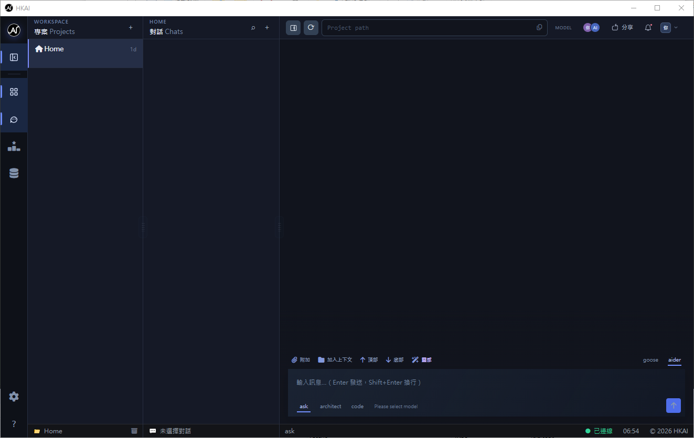
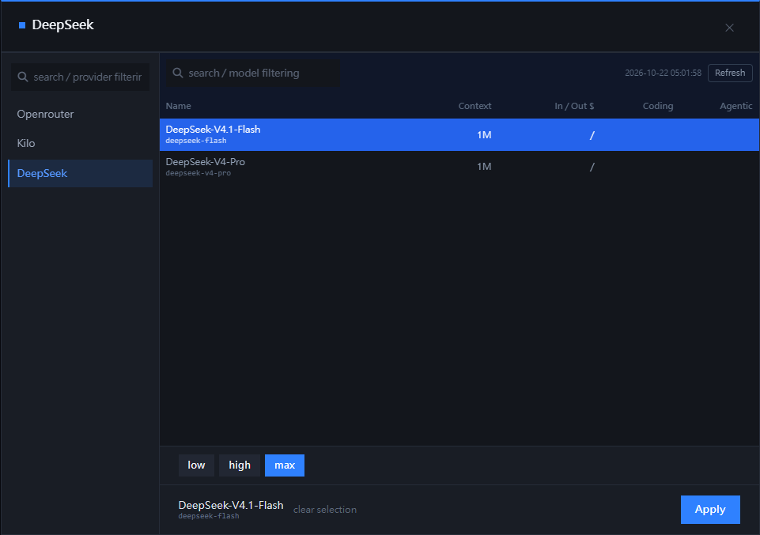
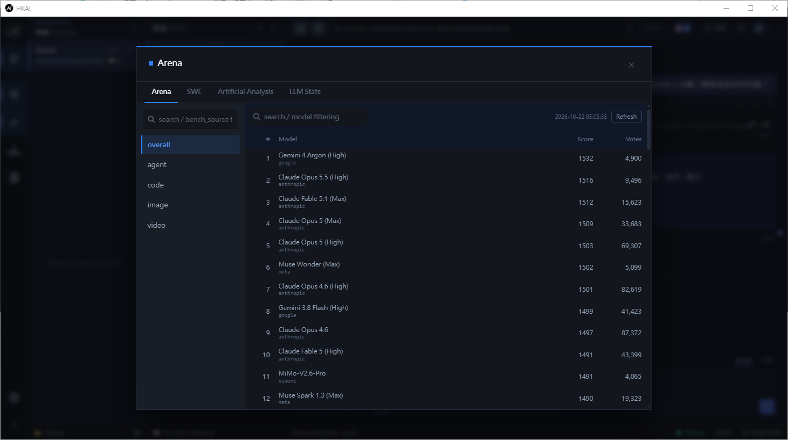

<!-- AUTO-GENERATED: edit section files under .github/docs/README/0.1.0/zh-CN/; do not edit this file directly -->

[English](README.md) · [繁體中文](README.zh-HK.md) · **简体中文**

# HKAI

> 没有做不到，只有想不到。

本地 AI 开发控制台：PHP 网页界面 + Python 引擎 daemon + SQLite；源码与对话不会离开你的电脑。

<!-- screenshot: 01-projects（项目列表） -->

## 截图

## 功能

- **本地执行**：源码与对话只留在你的电脑，无云端依赖。
- **改文件前先批准**：AI 每次修改文件都会显示权限卡，你批准后才会动手。
- **引擎可切换**：goose 与 aider 共用同一界面，不绑定单一 agent。
- **项目互相隔离**：对话、历史、工作目录各自独立。
- **内置排行榜**：SWE-bench、LMArena、AA、LLM Stats，选模型有依据。
- **长任务可观察**：进程查看 + activity log，可随时中止。

<!-- screenshot: 02-chat-permission（对话 + 权限卡） -->

## 系统要求

Windows 10/11（x64）· Python 3.13 · 约 3 GB 磁盘空间

<!-- screenshot: 03-settings（设置页） -->

## 快速开始

二选一：

1. **便携版**：保持整个文件夹结构不变，然后双击 `execute/HKAI.exe`。
2. **手动**：在站点根目录执行 `php -S 127.0.0.1:8000 -t . url_rewrite.php`（PHP 8.4.26）。

## 适用范围

单一工作站、单一操作者；以本地项目为单位的 AI 协作。

## 引擎（Agent）

| 引擎 | 说明 | 额外需要 |
|---|---|---|
| `goose` | Goose CLI 引擎 | 已附带 `externals/goose` |
| `aider` | Aider 引擎 | 已附带 `externals/aider`（或用 `.env` 指向自装位置） |

## 支持的供应商

| 供应商 | 获取 API Key | 备注 |
|---|---|---|
| OpenRouter | <https://openrouter.ai/keys> | 可用免费模型 |
| Kilo | <https://kilo.ai> | 注册后获取 API Key |
| DeepSeek | <https://platform.deepseek.com/api_keys> | 按用量收费 |

以上三个已测试；其他供应商未经测试，可自行配置。

## 评分来源（Benchmark）

| 来源 | API Key | 网站 |
|---|---|---|
| SWE-bench | 不需要 | <https://www.swebench.com/> |
| LMArena | 不需要 | <https://lmarena.ai/> |
| Artificial Analysis | 需要 | <https://artificialanalysis.ai/> |
| LLM Stats | 需要 | <https://llm-stats.com/> |

## License

MIT License · Copyright (c) 2026 Henry Yau
