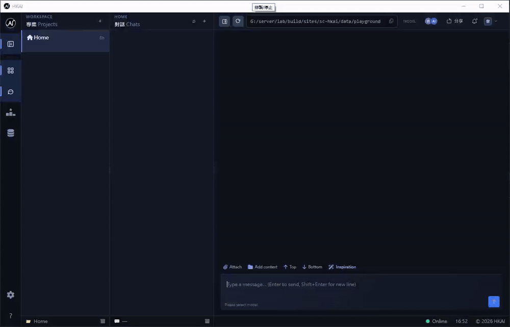
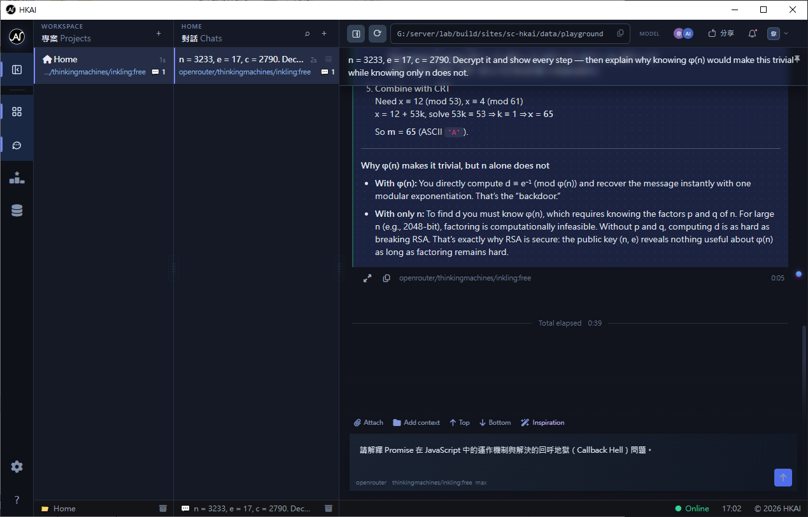
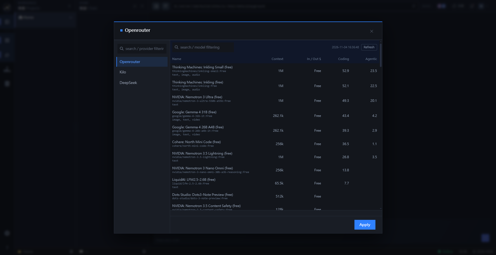
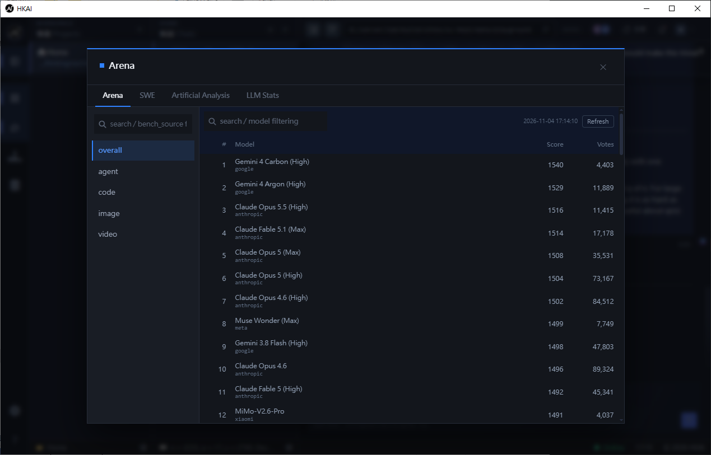

<!-- AUTO-GENERATED: edit section files under .deploy/github/docs/0.3.0/README/i18n/zh-HK/; do not edit this file directly -->

[English](README.MD) · **繁體中文** · [简体中文](README.zh-CN.md)

# HKAI

> 沒有做不到，只有想不到。

本機 AI 開發控制台：PHP 網頁介面＋Python 代理服務＋SQLite。原始碼同對話唔會離開你部機。

介面、HTTP 伺服器、PHP 執行環境同代理引擎全部放喺同一個資料夾——唔需要另裝 web server，亦唔需要連網都可以運行。

## 截圖

## 功能

- **本機運行**：原始碼、對話同歷史只留喺你部機，無雲端依賴。
- **改檔前先批准**：代理每次改檔前都會問你，批准之後才會動手。
- **自足運行**：雙擊產品資料夾內嘅 `HKAI.exe`——佢會轉去啟動 `execute\HKAI.exe`，起內建 Apache＋PHP-CGI，喺本機隨機埠開控制台。
- **離線可用**：前端 library（jQuery、Bootstrap、Markdown、Mermaid、CodeMirror…）全部隨資料夾附上，唔用 CDN。
- **串流逐段呈現**：回覆分成 thinking／result／工具調用三段，各自計時；每條命令有獨立複製掣。
- **問題隊列**：連續送多條，每對話一次跑一條，完成後自動接下一條。
- **Draft 上傳**：每條問題最多 13 張圖，先落 draft 資料夾、抽取完成才派工。
- **專案互相隔離**：對話、歷史、工作目錄各自獨立。
- **模型目錄與排行榜**：OpenRouter、Kilo、DeepSeek，配 SWE-bench、LMArena、AA、LLM Stats。
- **診斷**：程序檢視、activity log、git 狀態同 stage／commit 操作。
- **介面兩語**：English、繁體中文。

## 系統需求

| 項目 | 要求 |
|---|---|
| 作業系統 | Windows 10/11（x64） |
| WebView2 | Evergreen Runtime（Windows 11 已內建） |
| C++ runtime | Microsoft Visual C++ 2015–2022 Redistributable（x64） |
| Python | 已內建 3.13（毋須安裝） |
| 磁碟 | 約 3 GB |
| 網絡 | 運行唔需要；只有你設定嘅模型供應商需要 |

Apache 2.4.54 同 PHP 8.4.26 已內建——唔需要另裝 web server 或 PHP。

<!-- screenshot: 03-settings（設定頁） -->

## 快速開始

**免安裝**：解壓即用，毋須 admin、唔寫 registry；刪資料夾即移除（你嘅資料喺 `%LOCALAPPDATA%\seacorner\hkai\data`，只有 WebView2 快取同外殼 log 寫入 `%LOCALAPPDATA%\hkai.local.shell`）。

1. 解壓 release 資料夾，保持原本結構。位置由你決定——放喺 SSD（尤其 `data` 資料夾）載入同串流會明顯快啲。
2. 雙擊產品資料夾內嘅 `HKAI.exe`：佢會轉去啟動 `execute\HKAI.exe`，喺本機隨機埠起內建 Apache＋PHP-CGI 並開控制台；同一時間只行一個實例。
3. 首次運行會開安裝精靈：
   - **歡迎**（揀安裝介面語言）→ **前置檢查**（runtime、擴充、Python、可寫目錄）
   - **升級覆核**（只有偵測到既有資料庫才出現）→ **資料庫**：全新安裝，或升級——指向既有站台資料夾匯入其資料庫（舊庫會先改名成 `hkai_chat_data.sqlite.bak-<時間戳>`）
   - **設定**：時區同供應商 API key
   - **安裝** → 逐項結果 → **完成**
4. 去設定填 API key、準備模型清單：
   - 設定 → **供應商** → 貼入 **API Token** → 儲存
   - 按該供應商旁邊嘅 **重新整理**（tooltip：下載模型清單）拉取目錄
   - 喺對話頂部開模型選擇器（顯示「請選擇模型」），揀模型後按 **套用**
   - 清單係即時快照；想更新就再按 **重新整理**

### 手動模式（可選）

將站台根設為 document root，PHP 8.4 用 FCGI 執行，再用瀏覽器開。內建嘅 `execute/bin/apache2454` 同 `execute/bin/php8426` 可以直接重用。

### 更新到新版本

冇自動更新（app 係免安裝，資料放喺你指定嘅位置）：

1. 關閉 `HKAI.exe`
2. 解壓新版本覆蓋舊資料夾，但保留你嘅資料夾 `%LOCALAPPDATA%\seacorner\hkai\data` 同發佈包附帶嘅 `.env`
3. 再開 `HKAI.exe`——會直接用既有資料庫，毋須重跑安裝

### 切換執行環境版本

`execute/config.toml` 用資料夾名指向內建 runtime（`apache_dir`、`php_dir`）同外部設定接口（`custom_dir`）。放新版本資料夾、改呢幾個 key 就生效——唔需要 rebuild。

### 引擎

Goose CLI 已附喺 `execute/goose`，經 ACP 驅動。內建解譯器係 `execute\python313\python.exe`；只有想用其他版本才喺 `.env` 設 `python_executable=`。

## 你嘅資料、備份同搬機

所有程式寫入嘅資料都喺同一個資料根（預設 `%LOCALAPPDATA%\seacorner\hkai\data`）：

| 內容 | 位置 |
|---|---|
| **對話、專案、訊息（資料庫）** | `%LOCALAPPDATA%\seacorner\hkai\data\localdb\hkai_chat_data.sqlite` |
| 訊息檔案同圖片 | `data/messages/`（`draft`、`polling`、`archive`；附件喺每條訊息隔離） |
| 供應商金鑰同機器設定 | `<data>/config/api_keys.json`、`<data>/config/settings.json` 同 `data/runtime.json` |
| 日誌 | `data/logs/` |

**SQLite 檔係最重要嗰個**——所有對話同專案都喺入面。圖片以檔案形式存喺訊息隔離，唔會入資料庫。

### 保留期

由 0.2.0 開始，本機檔案預設保留。已歸檔嘅訊息資料夾超過**一年**會自動刪除（連同圖片）；每日 log 保留 **30 日**。你想早啲刪，可以喺 app 內刪對話，或者直接刪 `data/messages/archive` 下嘅資料夾。

### 備份

1. 關閉 `HKAI.exe`
2. 複製整個 `data` 資料夾（資料庫＋所有訊息檔案）去你嘅備份位置
3. 咁就夠——安裝資料夾同 `.env` 唔會變，供應商金鑰同設定都喺資料根內

### 搬去另一部機

複製產品資料夾，再將資料根（`%LOCALAPPDATA%\seacorner\hkai\data`）複製去新機同一個位置，然後開 `HKAI.exe`。因為已有資料庫，安裝精靈會跳過。

### 還原

關閉 app，用備份嘅 `data` 覆蓋返，再開 app。

## 故障排查

先查兩個最常見原因：**已經有另一份開住**，或者**檔案被其他程式鎖住**。

| 症狀 | 做法 |
|---|---|
| 開唔到，或者白畫面 | 等幾秒，再開一次 `HKAI.exe`——佢會聚焦現有窗，唔會開第二份 |
| 提示「已有一個實例運行中」 | 上一次未關：喺工作列關閉，再開 |
| 安裝／升級喺資料庫一步失敗 | 關閉所有 `HKAI.exe` 同資料庫工具，再按 **Install**。舊資料庫唔會被改動 |
| 訊息一直「排隊中」或者轉圈唔停 | 睇右下角狀態點；重開 app——排隊訊息存喺磁碟，會續跑 |
| 模型清單空白 | 貼好供應商 key、儲存，再喺模型選擇器按 **重新整理** |
| 供應商回 401／403 |
| 對話回覆顯示「API key 被拒絕」 | 供應商拒絕咗條 key——去「設定 › 供應商」貼返該供應商有效嘅 key，儲存後再送一次 | key 錯或過期——重新建立並貼上 |
| 完全連唔到網 | app 本身離線可用；回答問題要供應商網絡。檢查 proxy／VPN |
| Windows 攔截（SmartScreen） | **更多資訊** → **仍要執行**；執行檔未做代碼簽章 |
| 防毒刪咗檔案 | 將產品資料夾加入防毒排除，再重新解壓 |

### 仍然解決唔到？

- 開 **About**（左邊 rail 最底嘅 **?**）→ **回報問題**，或者去 <https://github.com/henry-wiki/hkai/issues>
- 請附上：版本（About 有顯示）、Windows 版本、`data/logs/hkai.<日期>.log` 最後幾行

### 日誌位置

- `data/logs/hkai.<日期>.log`——應用日誌
- `data/logs/goose_daemon.audit.log`——代理活動
- `%LOCALAPPDATA%\hkai.local.shell\logs\hkai.log`——桌面外殼日誌

### 重置

刪 `data` 資料夾，再跑安裝精靈。呢步會清走對話同歷史——要保留就先複製資料夾。

## 解除安裝

HKAI 係免安裝：冇安裝程式、冇 registry 項目、冇 Windows 服務。

1. 關閉 `HKAI.exe`
2. 刪除產品資料夾
3. 刪除資料根（`%LOCALAPPDATA%\seacorner\hkai\data`）

第 2 步只移除程式；第 3 步才移除對話、專案同附件。想保留就先備份資料根。

### 會遺留嘅東西

有幾樣嘢放喺產品資料夾以外，**刪資料夾唔會**幫你清：

- 資料根 `%LOCALAPPDATA%\seacorner\hkai\data`——對話、鎖匙同設定（要清就自己刪）
- `%LOCALAPPDATA%\hkai.local.shell`——WebView2 快取同外殼 log（可以自行刪）
- WebView2 Runtime、Visual C++ Redistributable（如果你另外裝過）——其他軟件有用就保留

刪咗資料夾就冇回頭：之後 app 已經唔存在，冇辦法幫你清嗰啲遺留項目。

## 適用範圍

單一工作站、單一操作者；AI 協作範圍限於本機專案。支援平台為 Windows 10/11。

## 資料同私隱

- **留喺本機**：對話、訊息、附件、歷史、log 同串流快照全部喺 `<data>/`；供應商金鑰喺 `<data>/config/api_keys.json`。
- **會離開本機嘅只有**：你送出嘅內容——問題文字、附加圖片，以及代理讀取嘅專案上下文——經 HTTPS 送去你設定嘅模型供應商（OpenRouter、Kilo 或 DeepSeek）。佢哋保留咩資料，受佢哋自己嘅政策規管。
- **排行榜**：開 benchmark 分頁時會抓 SWE-bench、LMArena、Artificial Analysis、LLM Stats 嘅公開頁面。
- **冇 telemetry**：冇 analytics、冇使用統計、冇更新檢查、冇 CDN 請求——前端 library 全部本地。
- **網絡暴露**：控制台只綁 `127.0.0.1`，其他機器連唔到。
- **金鑰儲存**：API key 以明文存喺磁碟上嘅 `<data>/config/api_keys.json`；請保管好個資料夾。介面只會顯示遮罩（尾 4 位）。
- **代理範圍**：代理可以讀取專案工作目錄內嘅檔案、執行命令；每次改檔前都要你批准。
- **清除資料**：刪除資料根（`%LOCALAPPDATA%\seacorner\hkai\data`）；只剩 `%LOCALAPPDATA%\hkai.local.shell` 內嘅 WebView2 快取同 log。

## 引擎（Agent）

| 引擎 | 說明 | 額外需求 |
|---|---|---|
| `goose` | Goose CLI（經 ACP 協定驅動） | 已附喺 `execute/goose` |

引擎由站台設定嘅 `daemon_engine` 決定；現時支援值為 `goose_daemon`。

## 支援嘅供應商

| 供應商 | 網站 | 備註 |
|---|---|---|
| OpenRouter | <https://openrouter.ai> | 有免費模型 |
| Kilo | <https://kilo.ai> | Kilo AI Gateway 帳戶 |
| DeepSeek | <https://platform.deepseek.com> | 按用量收費 |

### 點樣取得 API key

**OpenRouter**

1. 去 <https://openrouter.ai> 登入
2. 開 <https://openrouter.ai/keys>，建立新 key
3. 複製 key——只會顯示一次

**Kilo**（Kilo AI Gateway）

1. 去 <https://app.kilo.ai> 登入
2. 喺**個人帳戶**（唔係組織）開 **Your Profile**
3. 拉到頁面最底，複製 API key

**DeepSeek**

1. 去 <https://platform.deepseek.com> 登入
2. 開 <https://platform.deepseek.com/api_keys>，建立新 key
3. 複製 key

### 貼去邊

設定 → **供應商** → 貼入 **API Token** → 儲存。金鑰只存喺本機 `<data>/config/api_keys.json`；除咗你設定嘅供應商，唔會送去其他地方，介面亦只會顯示遮罩。

其他供應商未經測試，設定風險自負。

## 基準數據來源

| 來源 | API key | 網站 |
|---|---|---|
| SWE-bench | 不需要 | <https://www.swebench.com/> |
| LMArena | 不需要 | <https://lmarena.ai/> |
| Artificial Analysis | 需要 | <https://artificialanalysis.ai/> |
| LLM Stats | 需要 | <https://llm-stats.com/> |

## 授權

MIT License · Copyright (c) 2026 Henry Yau

Apache、PHP 及隨附前端 library 各自保留原有授權——詳見 `THIRD_PARTY_LICENSES.md`。
